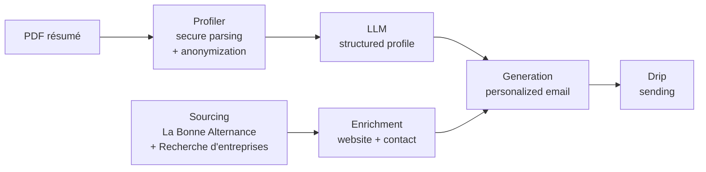

# Avenly

**Your future starts in the hidden job market.**

Avenly is a Python engine that automates access to the **hidden apprenticeship market** (*alternance*, the French work-study system): it identifies companies that hire apprentices without posting job offers, analyzes the candidate's résumé without ever exposing personal data, and prepares targeted unsolicited applications.


[](https://github.com/lrfsami/avenly/actions/workflows/ci.yml)


[🇫🇷 Français](README.md) · 🇬🇧 English

---

## The problem

A large share of apprenticeship contracts is **never posted** as a job offer: companies hire through referrals, unsolicited applications or their own network. Meanwhile, students all apply to the same visible offers, and companies that take on apprentices without advertising it stay off the radar.

## The solution

Avenly combines **French government public APIs** to map this hidden market, then automates personalized outreach.



| Module | Role | Status |
|---|---|---|
| `profiler.py` | Secure résumé parsing and anonymization | ✅ |
| `sourcing.py` | Company targeting by field and location | ✅ |
| `security.py` | Encryption and personal data anonymization | ✅ |
| `storage.py` | Shared company catalogue, application history, opt-out list | ✅ |
| `llm.py` | LLM profile extraction (skills, experience) with a spending budget | ✅ |
| `enricher.py` | Website context and recruiter contact | 🚧 |
| `sender.py` | Email drafting (under 120 words) and sending | 🚧 |

## Security by design

Avenly handles résumés: data protection is not an afterthought, it shapes the code.

- **No personal data sent to LLMs.** Emails, phone numbers (French and international formats), postal addresses and the candidate's name are replaced with `[CONFIDENTIEL]` before any external processing.
- **In-memory résumé processing only.** The PDF is read through `io.BytesIO`; no copy is ever written to disk.
- **Strict file validation.** `%PDF-` magic bytes checked (the extension proves nothing), size and page count limited, encrypted or corrupted PDFs rejected.
- **Resistance to malicious content.** Bounded-quantifier regexes (ReDoS protection) and removal of invisible Unicode characters, often used to hide prompt injections.
- **Symmetric encryption.** Sensitive data encrypted with Fernet (AES-128-CBC + HMAC-SHA256), key stored outside the code.
- **Secrets never exposed.** Keys and tokens typed as `SecretStr`: masked in logs, `print` output and even configuration error messages.
- **Sanitized external data.** URLs filtered (`javascript:`, `file:`, `localhost` and IPs rejected, groundwork for SSRF protection), control characters stripped, SIRET and NAF codes validated.
- **GDPR compliance.** Companies with restricted visibility in the SIRENE registry are excluded, and executives' personal data returned by the API is never read.
- **Controlled network calls.** Timeouts, retries with backoff, per-API rate limiting and bounded response size.
- **No secrets in code.** `gitleaks` blocks any commit containing a key or token, locally (pre-commit hook) and in CI across the full history.
- **Hardened CI.** GitHub Actions with least-privilege permissions and actions pinned by commit SHA.
- **LLM under control.** The résumé is passed as data between tags, never as instructions, and the response is constrained to a JSON schema (prompt-injection protection). Every call records its actual cost, and a monthly budget, global and per client, blocks calls before they are sent.
- **Static analysis.** The `ruff` linter includes Bandit security rules.

## Architecture

```
src/avenly/
├── config.py     # Typed, validated configuration (.env), masked secrets
├── models.py     # Shared Pydantic models (Company, GeoPoint)
├── security.py   # Fernet encryption + personal data anonymization
├── profiler.py   # Secure in-memory PDF résumé parsing
├── sourcing.py   # HTTP client, geocoding, company sources, SIRET-based merge
├── storage.py    # Database: shared catalogue, cache, applications, opt-outs
└── llm.py        # LLM profile extraction (provider-agnostic interface), cost tracking
tests/            # pytest suite, mocked APIs (no network calls by default)
```

Design choices:

- **The engine is interface-agnostic.** The same code will power the command-line script and later a FastAPI backend.
- **Company sources share a common interface** (`CompanySource`): adding a source means adding a class.
- **Multi-tenant from day one.** Every object carries a `client_id`, anticipating a B2B offer for training centers.
- **SIRET (French company ID) is the unique key**: it deduplicates results across sources and will later prevent contacting the same company twice.
- **A shared company catalogue.** Recent searches are served from the database, and a given company receives at most 2 Avenly applications per month across all clients, to avoid flooding it.

## Installation

```bash
git clone https://github.com/lrfsami/avenly.git
cd avenly
python3 -m venv .venv
source .venv/bin/activate
pip install -r requirements.txt
cp .env.example .env
pre-commit install   # automatic checks before each commit (secrets, lint)
```

Generate an encryption key and paste it into `.env` (`FERNET_KEY=...`):

```bash
python -m avenly.security
```

To enable La Bonne Alternance, request a token at [api.apprentissage.beta.gouv.fr](https://api.apprentissage.beta.gouv.fr) and set `LBA_API_TOKEN`. Without a token, only the Recherche d'entreprises API is used.

## Usage

```python
from avenly.profiler import read_cv
from avenly.sourcing import find_companies

cv = read_cv("data/my_resume.pdf", candidate_names=["First Last"])
print(cv.text)  # anonymized text, ready for an LLM

companies = find_companies("informatique", "Lyon", client_id="me", radius_km=20)
for company in companies[:10]:
    print(company.name, company.siret, company.address)
```

Available fields: `informatique` (IT), `data` (data / AI), `marketing`, `comptabilite` (accounting), `rh` (HR).

## Tests

```bash
pytest               # fast tests, no network
pytest -m network    # tests against the real APIs
ruff check .         # lint and security rules
pre-commit run --all-files  # all checks, including secret detection
```

## Roadmap

**Month 1: the engine**
- [x] Configuration, encryption, anonymization
- [x] Secure résumé parsing
- [x] Multi-API sourcing with SIRET-based merge
- [x] LLM profile extraction (Pydantic-validated JSON)
- [ ] Enrichment: website and contact
- [ ] Email generation and SMTP sending
- [ ] Command-line interface

**Month 2: automated sending**
- [x] Database: shared catalogue, search cache, application history (no duplicate contact), opt-out list
- [ ] Queue with spaced-out sending
- [ ] Gmail / Outlook OAuth2 login

**Month 3: the product**
- [ ] FastAPI backend
- [ ] Web dashboard
- [ ] Training-center workspace to follow multiple students

## Author

**Sami Laarfi** · [@lrfsami](https://github.com/lrfsami)

© 2026 Sami Laarfi. All rights reserved.
