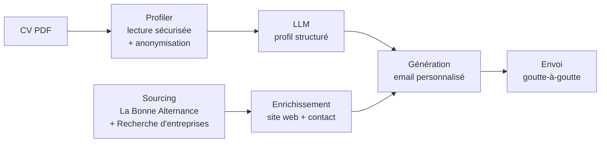

# Avenly

**Ton avenir commence dans le marché caché.**

Avenly est un moteur Python qui automatise l'accès au **marché caché de l'alternance** : il identifie les entreprises qui recrutent sans publier d'offre, analyse le CV du candidat sans jamais exposer ses données personnelles, et prépare des candidatures spontanées ciblées.


🇫🇷 Français · [🇬🇧 English](README.en.md)

---

## Le problème

Une grande partie des contrats en alternance n'est **jamais publiée** sous forme d'offre : les entreprises recrutent par cooptation, candidatures spontanées ou via leur réseau. Pendant ce temps, les étudiants postulent tous aux mêmes offres visibles, et les entreprises qui accueillent des alternants sans le dire restent hors radar.

## La solution

Avenly croise des **APIs publiques de l'État** pour cartographier ce marché caché, puis automatise une prospection personnalisée.



| Module | Rôle | Statut |
|---|---|---|
| `profiler.py` | Lecture sécurisée du CV et anonymisation | ✅ |
| `sourcing.py` | Ciblage des entreprises par domaine et localisation | ✅ |
| `security.py` | Chiffrement et anonymisation des données personnelles | ✅ |
| LLM → profil JSON | Extraction des compétences et expériences | 🚧 |
| `enricher.py` | Contexte du site web et contact recruteur | 🚧 |
| `sender.py` | Rédaction (moins de 120 mots) et envoi | 🚧 |

## Sécurité dès la conception

Avenly manipule des CV : la protection des données n'est pas une option ajoutée après coup, elle structure le code.

- **Aucune donnée personnelle envoyée aux LLM.** Emails, téléphones (formats français et internationaux), adresses postales et nom du candidat sont remplacés par `[CONFIDENTIEL]` avant tout traitement externe.
- **CV traités en mémoire uniquement.** Le PDF est lu via `io.BytesIO`, aucune copie n'est écrite sur le disque.
- **Validation stricte des fichiers.** Signature `%PDF-` vérifiée (l'extension ne prouve rien), taille et nombre de pages limités, PDF chiffrés ou corrompus refusés.
- **Résistance aux contenus piégés.** Regex à quantificateurs bornés (protection ReDoS) et suppression des caractères Unicode invisibles, souvent utilisés pour cacher des injections de prompt.
- **Chiffrement symétrique.** Données sensibles chiffrées avec Fernet (AES-128-CBC + HMAC-SHA256), clé stockée hors du code.
- **Secrets jamais exposés.** Clés et jetons typés `SecretStr` : masqués dans les logs, les `print` et même les messages d'erreur de configuration.
- **Données externes assainies.** URLs filtrées (`javascript:`, `file:`, `localhost` et IP rejetés, base d'une future protection SSRF), caractères de contrôle supprimés, SIRET et codes NAF validés.
- **Respect du RGPD.** Les entreprises en diffusion restreinte dans SIRENE sont exclues, et les données personnelles des dirigeants renvoyées par l'API ne sont jamais lues.
- **Appels réseau maîtrisés.** Timeouts, relances avec backoff, limitation de débit par API et taille de réponse bornée.
- **Analyse statique.** Le lint `ruff` inclut les règles de sécurité Bandit.

## Architecture

```
src/avenly/
├── config.py     # Configuration typée et validée (.env), secrets masqués
├── models.py     # Modèles Pydantic partagés (Company, GeoPoint)
├── security.py   # Chiffrement Fernet + anonymisation des données personnelles
├── profiler.py   # Lecture sécurisée du CV PDF en mémoire
└── sourcing.py   # Client HTTP, géocodage, sources d'entreprises, fusion par SIRET
tests/            # Tests pytest, APIs simulées (aucun appel réseau par défaut)
```

Choix d'architecture :

- **Le moteur est indépendant de l'interface.** Le même code servira le script en ligne de commande puis une API FastAPI.
- **Les sources d'entreprises partagent une interface commune** (`CompanySource`) : ajouter une source revient à ajouter une classe.
- **Plusieurs clients dès le départ.** Chaque objet porte un `client_id`, en prévision d'une offre B2B pour les CFA.
- **Le SIRET est la clé unique** : il sert à dédoublonner les résultats entre sources et, plus tard, à ne jamais contacter deux fois la même entreprise.

## Installation

```bash
git clone https://github.com/lrfsami/avenly.git
cd avenly
python3 -m venv .venv
source .venv/bin/activate
pip install -r requirements.txt
cp .env.example .env
```

Générer une clé de chiffrement et la coller dans `.env` (`FERNET_KEY=...`) :

```bash
python -m avenly.security
```

Pour activer La Bonne Alternance, demander un jeton sur [api.apprentissage.beta.gouv.fr](https://api.apprentissage.beta.gouv.fr) et le renseigner dans `LBA_API_TOKEN`. Sans jeton, seule l'API Recherche d'entreprises est utilisée.

## Utilisation

```python
from avenly.profiler import read_cv
from avenly.sourcing import find_companies

cv = read_cv("data/mon_cv.pdf", candidate_names=["Prénom Nom"])
print(cv.text)  # texte anonymisé, prêt pour un LLM

companies = find_companies("informatique", "Lyon", client_id="moi", radius_km=20)
for company in companies[:10]:
    print(company.name, company.siret, company.address)
```

Domaines disponibles : `informatique`, `marketing`, `comptabilite`, `rh`.

## Tests

```bash
pytest               # tests rapides, sans réseau
pytest -m network    # tests contre les vraies APIs
ruff check .         # lint et règles de sécurité
```

## Feuille de route

**Mois 1 : le moteur**
- [x] Configuration, chiffrement, anonymisation
- [x] Lecture sécurisée du CV
- [x] Sourcing multi-API avec fusion par SIRET
- [ ] Extraction du profil par LLM (JSON validé par Pydantic)
- [ ] Enrichissement : site web et contact
- [ ] Génération de l'email et envoi SMTP
- [ ] Interface en ligne de commande

**Mois 2 : l'envoi automatisé**
- [ ] Historique des envois en base de données (pas de double contact)
- [ ] File d'attente avec envoi espacé
- [ ] Connexion OAuth2 Gmail / Outlook

**Mois 3 : le produit**
- [ ] API backend FastAPI
- [ ] Tableau de bord web
- [ ] Espace CFA pour suivre plusieurs étudiants

## Auteur

**Sami Laarfi** · [@lrfsami](https://github.com/lrfsami)

© 2026 Sami Laarfi. Tous droits réservés.
